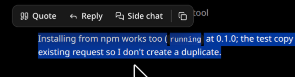
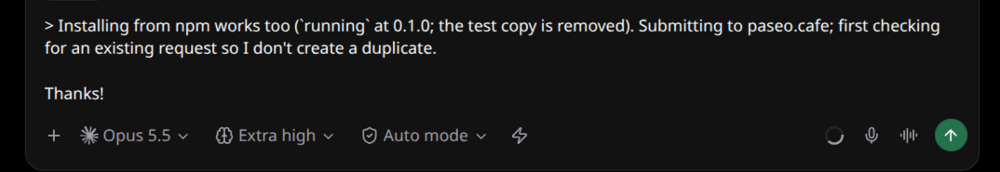
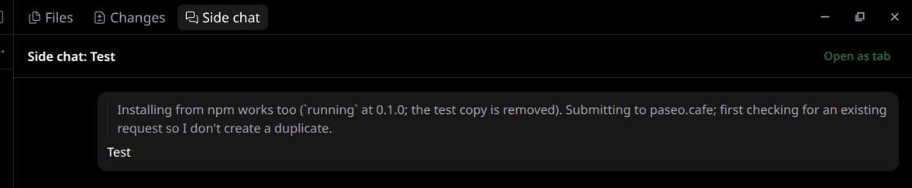

# Quote for Paseo

Reply to a piece of an agent's answer instead of the whole thing. Select text in a chat and a
small bar appears above it.



### Quote

Puts the selection into this chat's message box as a `> quote` and leaves the cursor under it.
Type your answer, select the next paragraph, quote again, and send everything as one message. The
quote always lands in the chat it came from, even with several tabs or split panes.



### ok and explain

Canned replies: each sends the selection to the agent at once, as a `> quote` followed by `ok`
or `explain`. While the agent is running, they follow **Settings → Default send** (interrupt,
steer, or queue), as the message box does. If sending fails, the quote and reply land in the message box instead.

### Side chat

Asks about the passage in a separate agent next to the main chat, so the main thread stays on
track. It uses the same provider, model, mode, and thinking level, opens in the right-hand panel,
and takes follow-ups there. **Open as tab** turns it into a regular chat tab. It is a subagent of
the main chat and is archived with it.



### Copy

Copies the selection as Markdown: lists, tables, emphasis, and code fences survive.

Quotes of assistant messages keep their Markdown. Multi-line code becomes a fenced block rather
than a quote.

## Install

Requires Paseo 0.10.1 or later. Enable plugins under **Settings → Plugins**, then:

```bash
paseo plugin install npm:paseo-quote
# or from GitHub
paseo plugin install github:keefeere/paseo-quote
```

Plugins are trusted code. This one runs only in the app: it reads the chat you select from and
writes into its message box. It has no daemon-side code.

## Keys

| Where        | Key                  | Effect                                        |
| ------------ | -------------------- | --------------------------------------------- |
| Side chat    | Enter                | Ask                                           |
| Side chat    | Shift+Enter          | New line                                      |
| Side chat    | Esc                  | Cancel                                        |

Dismiss the bar by clicking elsewhere. Esc in the chat itself is Paseo's "interrupt agent".

## Limitations

- Desktop and web apps only. iOS and Android route selection through the system menu, which a
  plugin cannot extend.
- Paseo has no plugin API for the message box, so the plugin works with the app's markup. The
  selectors it relies on are listed at the top of `client/web.ts`; a later Paseo release may need
  an update.
- Connected to several daemons with the plugin on each, the page shows one bar; **ok**,
  **explain**, and side chats go to whichever daemon owns the selected agent.
- With **Default send** set to queue, a canned reply sent while the agent runs waits in the
  plugin, not in the message box's queue, and is lost if the app reloads first.
- A side chat is a fresh session: Paseo cannot fork a conversation. It sees the quote, the
  message it came from, and the last 8 turns of the main chat.
- The side chat panel renders Markdown simply: code blocks and quotes, no emphasis. Open it as a
  tab for the full renderer.

## Develop

```bash
npm install
npm run typecheck
paseo plugin install "$PWD"   # first time
paseo plugin reload quote
```

On the Linux AppImage, `paseo` treats an existing absolute directory argument as "open project".
Install from a local checkout with the parent-and-subpath form instead:
`paseo plugin install "$(dirname "$PWD"):$(basename "$PWD")"`.

## License

MIT
